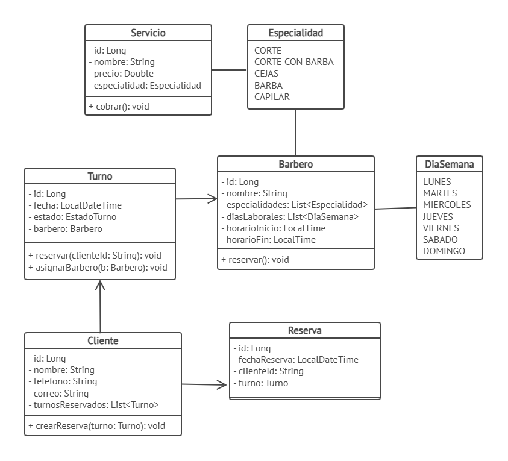

# DOSW_ParcialT2_CristianOrtiz

## Índice
1. Datos del estudiante
2. Descripción del proyecto
3. Despliegue
4. Estructura del proyecto
5. Tecnologías y dependencias
6. Configuración y variables de entorno
7. Cómo ejecutar
8. Pruebas
9. Docker
10. CI/CD
11. Herramientas de modelado y diseño (evidencias)

## 1. Datos del estudiante
**Nombre:** Cristian Camilo Ortiz Sanchez
**Grupo:** 1

## 2. Descripción del proyecto
Qué es el servicio y para qué se usa (3–5 líneas).

## 3. Despliegue

**URL del servicio en Azure:** [https://portal.azure.com/#@pruebacorreoescuelaingeduco.onmicrosoft.com/resource/subscriptions/25a8e71c-d600-48a1-8951-583bb7675b78/resourceGroups/dosw/providers/Microsoft.Web/sites/parcial-dosw/appServices](https://portal.azure.com/#@pruebacorreoescuelaingeduco.onmicrosoft.com/resource/subscriptions/25a8e71c-d600-48a1-8951-583bb7675b78/resourceGroups/dosw/providers/Microsoft.Web/sites/parcial-dosw/appServices)

**URL del health:** [https://parcial-dosw-apb3dvdfg8fvhtcb.northcentralus-01.azurewebsites.net/api/v1/health](https://parcial-dosw-apb3dvdfg8fvhtcb.northcentralus-01.azurewebsites.net/api/v1/health)

**URL de Swagger:** [https://parcial-dosw-apb3dvdfg8fvhtcb.northcentralus-01.azurewebsites.net/swagger-ui/index.html](https://parcial-dosw-apb3dvdfg8fvhtcb.northcentralus-01.azurewebsites.net/swagger-ui/index.html)

## 4. Estructura del proyecto
```
DOSW_ParcialT2_CristianOrtiz/
│
├── docs/
│   ├── uml/                      # diagramas fuente (draw.io / Lucidchart / Miro)
│   └── images/                   # exportes PNG/SVG y evidencias del README
│
├── src/
│   ├── main/
│   │   ├── java/edu/dosw/parcial/
│   │   │   ├── controller/
│   │   │   │   ├── dtos/
│   │   │   │   │   ├── request/
│   │   │   │   │   └── response/
│   │   │   │   ├── mappers/      # Mapper IN: DTO ↔ Dominio
│   │   │   │   └── handlers/     # GlobalExceptionHandler
│   │   │   │
│   │   │   ├── core/
│   │   │   │   ├── services/
│   │   │   │   ├── models/       # objetos de dominio
│   │   │   │   ├── validators/
│   │   │   │   └── utils/
│   │   │   │
│   │   │   ├── persistence/
│   │   │   │   ├── entities/     # clases @Document (MongoDB)
│   │   │   │   ├── repositories/ # MongoRepository
│   │   │   │   └── mappers/      # Mapper OUT: Dominio ↔ Document
│   │   │   │
│   │   │   ├── config/           # SecurityConfig, SwaggerConfig
│   │   │   └── main/             # clase con @SpringBootApplication
│   │   │
│   │   └── resources/
│   │       └── application.yaml  # o application.properties (usar solo uno)
│   │
│   └── test/
│       ├── java/edu/dosw/parcial/
│       │   ├── controller/
│       │   ├── core/
│       │   └── persistence/
│       └── resources/
│
├── Dockerfile
├── .dockerignore
├── .github/workflows/            # pipeline
├── pom.xml
├── .gitignore
└── README.md
```

## 5. Tecnologías y dependencias

| Dependencia / Plugin | Versión | Para qué se usa |
| :--- | :--- | :--- |
| `spring-boot-starter-web` | 4.1.1 (Heredada del parent) | Permite construir aplicaciones web y servicios RESTful |
| `spring-boot-starter-data-mongodb` | 4.1.1 (Heredada del parent) | Facilita la integración y persistencia con bases de datos MongoDB |
| `spring-boot-starter-validation` | 4.1.1 (Heredada del parent) | Permite la validación de DTOs utilizando anotaciones (Bean Validation) |
| `spring-boot-starter-security` | 4.1.1 (Heredada del parent) | Proveer esquemas de seguridad y autenticación en la aplicación |
| `jjwt-api`, `jjwt-impl`, `jjwt-jackson` | 0.12.6 | Soporte completo para la creación, procesamiento y validación de tokens JWT |
| `springdoc-openapi-starter-webmvc-ui` | 3.1.1 | Generación automática de la documentación interactiva de la API con Swagger |
| `lombok` | 1.18.36 | Reduce código repetitivo (getters, setters, constructores, etc.) mediante anotaciones |
| `mapstruct` | 1.5.5.Final | Mapeo eficiente y tipado entre objetos (como Entidades y DTOs) |
| `spring-boot-starter-test` | 4.1.1 (Heredada del parent) | Conjunto de librerías para pruebas que incluye JUnit, Mockito y herramientas de Spring Test |
| `spring-security-test` | 4.1.1 (Heredada del parent) | Proveer utilidades y soporte para realizar pruebas en endpoints protegidos por Spring Security |
| `spring-boot-maven-plugin` | 4.1.1 (Heredada del parent) | Permite empaquetar la aplicación en un JAR ejecutable y correrla mediante Maven |
| `maven-compiler-plugin` | Heredada (Configura procesadores: Lombok 1.18.36, lombok-mapstruct-binding 0.2.0, MapStruct 1.5.5.Final) | Compila el código fuente y procesa las anotaciones en el orden correcto para Lombok y MapStruct |
| `jacoco-maven-plugin` | 0.8.12 | Genera métricas y reportes de cobertura de código para las pruebas unitarias |
| `sonar-maven-plugin` | 3.10.0.2594 | Realiza el análisis estático de la calidad y seguridad del código para integrarlo con SonarQube |

## 6. Configuración y variables de entorno
 
| Variable / Secret | Descripción | Ejemplo (sin valores reales) |
| :--- | :--- | :--- |
| `DOCKERHUB_USERNAME` | Usuario de Docker Hub | `tu_usuario_docker` |
| `DOCKERHUB_TOKEN` | Access token de Docker Hub (no la contraseña) | `dckr_pat_123456789abcdef...` |
| `AZURE_CREDENTIALS` | JSON del Service Principal con acceso al grupo de recursos | `{"clientId": "...", "clientSecret": "...", "subscriptionId": "...", "tenantId": "..."}` |
| `AZURE_WEBAPP_NAME` | Nombre del App Service creado en Azure | `mi-app-service-dosw` |
| `JWT_SECRET` | Secret JWT Base64 (mínimo 44 caracteres) | `dGhpcy1pcy1hLXNlY3JldC1rZXktdGhhdC1pcy1sb25nLWVub3VnaC1mb3Itand0Cg==` |

**Requisitos previos:**
- Java JDK 21.
- Maven 3.9 o compatible.
- Docker instalado y en ejecución, para levantar MongoDB localmente.
- Variables de entorno configuradas.

**Pasos:**

1. Clonar el repositorio y entrar al directorio del proyecto:

   ```bash
   git clone https://github.com/CatrachoINXS/DOSW_ParcialT2_CristianOrtiz.git
   cd DOSW_ParcialT2_CristianOrtiz
   ```

2. Levantar MongoDB localmente con Docker, si todavía no está ejecutándose:

   ```bash
   docker run -d -p 27017:27017 --name mongo-parcial mongo:7
   ```

3. Configurar las variables de entorno en Windows PowerShell:

   ```powershell
   $env:MONGODB_URI="mongodb://localhost:27017/dosw_parcial"
   $env:JWT_SECRET="<SECRETO_BASE64>"
   ```

4. Compilar el proyecto y ejecutar las pruebas:

   ```bash
   mvn clean package
   ```

5. Iniciar la aplicación:

   ```bash
   mvn spring-boot:run
   ```

La aplicación estará disponible en `http://localhost:8080`.

### 7.2 Ejecución de MongoDB local con Docker

Si únicamente se necesita levantar una instancia local de MongoDB para ejecutar la aplicación con Maven, se pueden seguir estos pasos.

1. Descargar la imagen oficial de MongoDB:

   ```bash
   docker pull mongo:7
   ```

2. Crear e iniciar el contenedor con un volumen persistente:

   ```bash
   docker run -d --name mongo-parcial -p 27017:27017 -v mongo-dosw-data:/data/db mongo:7
   ```

3. Verificar que MongoDB esté en ejecución:

   ```bash
   docker ps
   ```

4. Configurar la variable de entorno en Windows PowerShell:

   ```powershell
   $env:MONGODB_URI="mongodb://localhost:27017/dosw_parcial"
   ```

5. Ejecutar la aplicación con Maven:

   ```bash
   mvn spring-boot:run
   ```
.

## 8. Pruebas
### 8.1. Ejecución de las pruebas

Desde la raíz del proyecto, ejecutar el siguiente comando:

```bash
mvn clean test
```

Para generar el reporte de cobertura con JaCoCo, ejecutar:

```bash
mvn jacoco:report
```

Si JaCoCo está configurado para ejecutarse durante la fase `verify`, también se puede utilizar:

```bash
mvn clean verify
```

### 8.2. Reporte de cobertura

El reporte HTML de JaCoCo se encuentra en la siguiente ruta, una vez generado:

```text
target/site/jacoco/index.html
```

## 9. Docker


## 10. CI/CD
El pipeline base compila, ejecuta las pruebas, construye la imagen, la publica en Docker Hub y la despliega en Azure. Va en .github/workflows/ci-cd.yml


## 11. Herramientas de modelado y diseño (evidencias)


---

# Resolución del parcial

## PUNTO 1
Excel : [docs/parcial-endpoints-punto-1](parcial-endpoints-punto-1)

### Preguntas para la revision con producto
a. ¿Cuál es la diferencia entre una validación de entrada y una validación de negocio? Seleccionen tres reglas del caso, incluyendo al menos una de cada tipo, y justifiquen su clasificación.

La validación de entrada verifica que la información llegue de manera correcta al sistema, esto quiere decir que, tenga la estructura y el formato que se solicita. Por ejemplo que no hayan nombres nulos, telefonos con más de 10 numeros o correos que no tengan en símbolo @. La validación del negocio es la que verifica que se cumplan las reglas de dominio. Por ejemplo cuando se habla de no duplicar turnos, o por ejemplo verificar que el barbero exista.

- regal 1. telefono debe tener 10 digitos numericos (validación de entrada). Es de entrada porque se valida antes de ejecutar la lógica de negocio.
- regla 2: El turno debe caer en un día de disponibilidad del barbero y dentro de su horario. Es validacion de negocio porqeu afecta la operacion real de la barbería definida en las reglas de negocio.
- regla 3: El servicio solicitado debe existir en el catálogo. Es validacion de negocio. Primero es una regla definida por el negocio y segundo se valida después de recibir los datos de entrada en los validadores de lógica de negocio.

b. En Pedir un turno, ¿cómo debe responder la API si fallan varias condiciones? Expliquen qué error se informa y qué cambios deben evitarse

La API debería responder con la primera condicion que falle. Si ingresa mal un dato en la entrada, no se debería continuar con la operacion hasta crear los objetos de dominio por ejemplo. Ahi mismo se deberia devolver el mensaje con el motivo del error,sin continuar con las validaciones.

## PUNTO 2 
 ### Diagrama de Componentes General


### Diagrama de Componentes Especifico


### Diagrama de Clases


### Preguntas para la revisión con Arquitectura
¿Qué problemas aparecen cuando no se separan correctamente las capas? Presenten un ejemplo del caso y expliquen cómo distribuyen sus responsabilidades.
- Si el dominio conoce detalles de HTTP, de MongoDB o de Spring Security, el negocio queda acoplado a la tecnología. Eso hace que cualquier cambio en la base de datos o en la capa web obligue a modificar entidades y reglas del negocio.
- Ejemplo: si Turno incluye anotaciones de persistencia y además valida directamente @RequestParam, entonces la lógica de negocio queda mezclada con la infraestructura. Esto rompe la separación y dificulta cambiar de MongoDB a otra base o de REST a otra interfaz.
- Nosotros distribuimos las responsabilidades de la siguiente forma: Controller recibe y responde HTTP, mientras que Service contiene la lógica de negocio y Validator aplica reglas del dominio. Mapper IN/OUT transforma DTOs y entidades, Repository persiste datos, Model representa sólo el dominio puro.

¿Qué diferencia existe entre un validador, una utilidad y un servicio? Ubiquen un ejemplo de cada uno en su diseño e indiquen su responsabilidad. 
- Un validador es un componente específico para comprobar una regla del negocio o una regla de entrada. Ejemplo: `TurnoValidator` valida fecha, horario, existencia del barbero y duplicidad.
- Una utilidad es una clase de apoyo con métodos auxiliares, sin lógica de negocio de dominio. Por ejemplo, una clase de utilidad para hacer operaciones con fechas (no tenemos ninguna contemplada en el MVP).
- Un servicio es un componente de negocio que orquesta operaciones y coordina validadores, mappers y repositorios. Ejemplo: `TurnoService` o `ReservaService` para crear un turno o reservarlo.

¿Qué diferencia existe entre el Mapper IN y el Mapper OUT? Indiquen dónde se ubican y qué representaciones transforman cada uno. 
- Mapper IN: Transforma los DTOs de entrada al modelo del Dominio y visceversa (se ubica entre el controller y el service).
- Mapper OUT: Transforma entidades del dominio a documentos de persistencia (Entity - MongoDB) y visceversa (se ubica entre el service y repository).

Retomen las tres reglas clasificadas en el paso anterior: ¿en qué componente debe ejecutarse cada una y por qué?
- Regla 1: En la primera regla se debe ejecutar una utilidad relacionada con cadenas. Por ejemplo una utilidad que valide que la cadena es un número telefónico porque tiene 10 caracteres y porque empieza con 3 por ejemplo.
- Regla 2: En TurnoValidator, ya que al generarse un nuevo turno, los horarios de este deben ajustarse al horario laboral del barbero. En dicho validador se verificaría esto
- Regla 3: En un validator porque es el componente que me permite comprobar que realmente exista el servicio

## PUNTO 3

## PUNTO 4
¿Cuál es la diferencia entre autenticación, autorización e integridad? Expliquen dónde y cómo aplicarán cada concepto en la API, con ejemplos del caso. 
- Autenticación: Es la comprobación de quién es el usuario. En la API, se aplica al inicio de sesión con email y contraseña, donde se valida la identidad del cliente o administrador y se devuelve un JWT.
- Autorización: Es la comprobación de qué puede hacer ese usuario. Por ejemplo, un cliente puede reservar y consultar sus turnos; un administrador puede crear turnos y ver todas las reservas. Esto se aplica con roles y permisos en Spring Security.
- Integridad: Asegura que los datos no se alteren ni corrompan durante la operación. En el caso del sistema, se protege la información del cliente, el total calculado de la reserva y el estado del turno para evitar cambios no autorizados o inconsistencias.

Seleccionen dos riesgos del OWASP Top 10 que se pueden encontrar en su API. Para cada uno, describan cómo se vería ese escenario aplicable a la barbería, su mitigación y cómo verificarían que el control funciona. 
- Broken Access Control (Control de acceso roto): Un cliente intenta consultar todas las reservas o crear turnos como administrador. La mitigación es validar el rol en cada endpoint con Spring Security y usar JWT con claims de rol. Para verificarlo, se ejecutan pruebas de integración con usuarios sin permisos y se valida que devuelvan 403 Forbidden.
- Injection / Validación débil: Si un usuario envía datos maliciosos en nombre, correo o teléfono, podría inyectarse texto no esperado o manipular consultas. La mitigación es validar entradas, usar tipos estrictos y prevenir concatenación de strings en consultas. Para verificarlo, se prueban entradas extremas y se comprueba que el sistema retorna errores controlados y no rompe la operación.

¿Cuál de los tipos de autenticación es el más adecuado para este MVP? Justifique su respuesta  
- Para este MVP, el tipo más adecuado es la autenticación basada en JWT. Es simple de implementa, no requiere mantener sesiones en servidor y funciona bien para servicios stateless como la barbería.
- Justificación: Cumple con los requerimientos de administración y cliente con roles diferenciados (cada petición incluye el token y el backend valida el rol del usuario).

## PUNTO 5
Explique cómo las pruebas aportan evidencia del cumplimiento de las reglas de negocio. Distingan qué verificarían con pruebas unitarias.
- Las pruebas aportan evidencia porque validan el comportamiento esperado en condiciones controladas. En un caso como reservar un turno, se prueba que la franja esté disponible, que el barbero tenga la especialidad, que no se repita la combinación fecha-hora y que el total calculado sea correcto.
- Las pruebas unitarias verificarían la lógica aislada: validadores, cálculo del total, selección del barbero disponible y estado del turno, mientras que las pruebas de integración verificarían el flujo completo de la API: endpoint, seguridad, base de datos y respuesta HTTP.

Explique brevemente y con justificación si considera que las pruebas por sí solas garantizan la ausencia de errores.
- No, las pruebas no garantizan la ausencia total de errores. Solo proporcionan evidencia práctica de que los casos previstos se comportan como se espera. Un sistema puede pasar pruebas y aun así tener errores no contemplados o condiciones de borde inesperadas. El enfoque correcto sería combinar pruebas unitarias y pruebas de integración para alcanzar un nivel razonable de confianza, siguiendo TDD: 
   - Definir el caso de falla o éxito
   - Implementarlo y finalmente refactorizar.

### TDD para Pedir un turno
Durante la prueba de Pedir un turno, se seguiría el flujo de TDD:
- ROJO: Se escribe el caso de prueba para un escenario exitoso y para cada rechazo (franja llena, servicio inexistente, correo inválido, etc.).
- VERDE: Se implementa la lógica mínima para que el caso pase.
- REFACTOR: Se simplifica el código manteniendo el comportamiento.

Se verifica que:
- El orden de validación se respeta: La API no continúa si falla la primera condición.
- El turno no cambia a OCUPADO si alguna regla falla.
- No se crea la reserva ni se modifica el turno en estados intermedios.
- Si la operación válida termina, entonces se actualiza el turno y se registra la reserva con el total calculado.

## PUNTO 6
