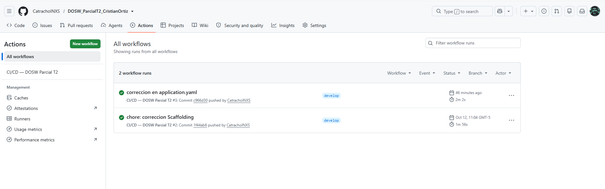
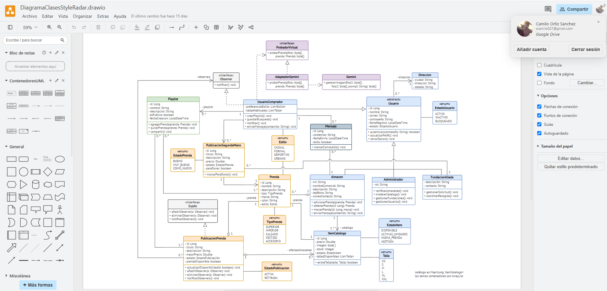
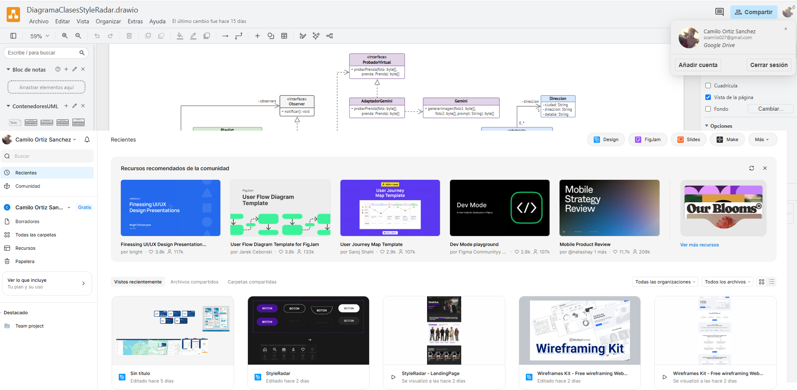
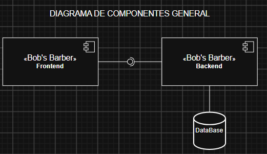
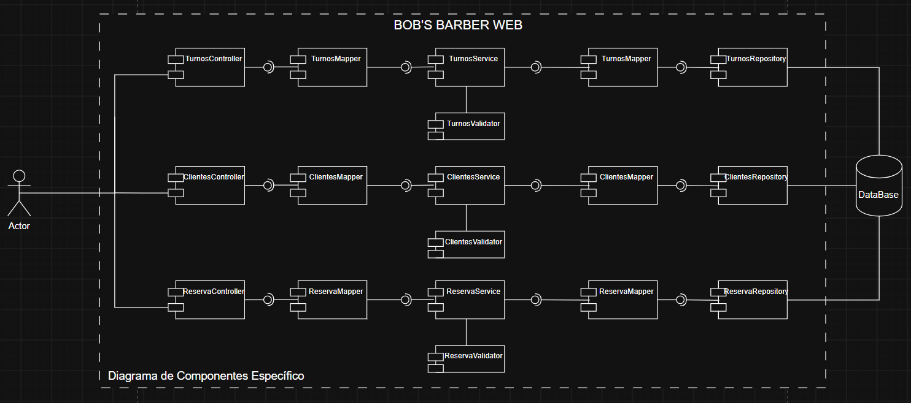

# DOSW_ParcialT2_CristianOrtiz

## Índice
1. Datos del estudiante
2. Descripción del proyecto
3. Despliegue
4. Estructura del proyecto
5. Tecnologías y dependencias
6. Configuración y variables de entorno
7. Cómo ejecutar
8. Pruebas
9. Docker
10. CI/CD
11. Herramientas de modelado y diseño (evidencias)

## 1. Datos del estudiante
**Nombre:** Cristian Camilo Ortiz Sanchez
**Grupo:** 1

## 2. Descripción del proyecto
Qué es el servicio y para qué se usa (3–5 líneas).

## 3. Despliegue

**URL del servicio en Azure:** [https://portal.azure.com/#@pruebacorreoescuelaingeduco.onmicrosoft.com/resource/subscriptions/25a8e71c-d600-48a1-8951-583bb7675b78/resourceGroups/dosw/providers/Microsoft.Web/sites/parcial-dosw/appServices](https://portal.azure.com/#@pruebacorreoescuelaingeduco.onmicrosoft.com/resource/subscriptions/25a8e71c-d600-48a1-8951-583bb7675b78/resourceGroups/dosw/providers/Microsoft.Web/sites/parcial-dosw/appServices)

**URL del health:** [https://parcial-dosw-apb3dvdfg8fvhtcb.northcentralus-01.azurewebsites.net/api/v1/health](https://parcial-dosw-apb3dvdfg8fvhtcb.northcentralus-01.azurewebsites.net/api/v1/health)

**URL de Swagger:** [https://parcial-dosw-apb3dvdfg8fvhtcb.northcentralus-01.azurewebsites.net/swagger-ui/index.html](https://parcial-dosw-apb3dvdfg8fvhtcb.northcentralus-01.azurewebsites.net/swagger-ui/index.html)

## 4. Estructura del proyecto
```
DOSW_ParcialT2_CristianOrtiz/
│
├── docs/
│   ├── uml/                      # diagramas fuente (draw.io / Lucidchart / Miro)
│   └── images/                   # exportes PNG/SVG y evidencias del README
│
├── src/
│   ├── main/
│   │   ├── java/edu/dosw/parcial/
│   │   │   ├── controller/
│   │   │   │   ├── dtos/
│   │   │   │   │   ├── request/
│   │   │   │   │   └── response/
│   │   │   │   ├── mappers/      # Mapper IN: DTO ↔ Dominio
│   │   │   │   └── handlers/     # GlobalExceptionHandler
│   │   │   │
│   │   │   ├── core/
│   │   │   │   ├── services/
│   │   │   │   ├── models/       # objetos de dominio
│   │   │   │   ├── validators/
│   │   │   │   └── utils/
│   │   │   │
│   │   │   ├── persistence/
│   │   │   │   ├── entities/     # clases @Document (MongoDB)
│   │   │   │   ├── repositories/ # MongoRepository
│   │   │   │   └── mappers/      # Mapper OUT: Dominio ↔ Document
│   │   │   │
│   │   │   ├── config/           # SecurityConfig, SwaggerConfig
│   │   │   └── main/             # clase con @SpringBootApplication
│   │   │
│   │   └── resources/
│   │       └── application.yaml  # o application.properties (usar solo uno)
│   │
│   └── test/
│       ├── java/edu/dosw/parcial/
│       │   ├── controller/
│       │   ├── core/
│       │   └── persistence/
│       └── resources/
│
├── Dockerfile
├── .dockerignore
├── .github/workflows/            # pipeline
├── pom.xml
├── .gitignore
└── README.md
```

## 5. Tecnologías y dependencias

| Dependencia / Plugin | Versión | Para qué se usa |
| :--- | :--- | :--- |
| `spring-boot-starter-web` | 4.1.1 (Heredada del parent) | Permite construir aplicaciones web y servicios RESTful |
| `spring-boot-starter-data-mongodb` | 4.1.1 (Heredada del parent) | Facilita la integración y persistencia con bases de datos MongoDB |
| `spring-boot-starter-validation` | 4.1.1 (Heredada del parent) | Permite la validación de DTOs utilizando anotaciones (Bean Validation) |
| `spring-boot-starter-security` | 4.1.1 (Heredada del parent) | Proveer esquemas de seguridad y autenticación en la aplicación |
| `jjwt-api`, `jjwt-impl`, `jjwt-jackson` | 0.12.6 | Soporte completo para la creación, procesamiento y validación de tokens JWT |
| `springdoc-openapi-starter-webmvc-ui` | 3.1.1 | Generación automática de la documentación interactiva de la API con Swagger |
| `lombok` | 1.18.36 | Reduce código repetitivo (getters, setters, constructores, etc.) mediante anotaciones |
| `mapstruct` | 1.5.5.Final | Mapeo eficiente y tipado entre objetos (como Entidades y DTOs) |
| `spring-boot-starter-test` | 4.1.1 (Heredada del parent) | Conjunto de librerías para pruebas que incluye JUnit, Mockito y herramientas de Spring Test |
| `spring-security-test` | 4.1.1 (Heredada del parent) | Proveer utilidades y soporte para realizar pruebas en endpoints protegidos por Spring Security |
| `spring-boot-maven-plugin` | 4.1.1 (Heredada del parent) | Permite empaquetar la aplicación en un JAR ejecutable y correrla mediante Maven |
| `maven-compiler-plugin` | Heredada (Configura procesadores: Lombok 1.18.36, lombok-mapstruct-binding 0.2.0, MapStruct 1.5.5.Final) | Compila el código fuente y procesa las anotaciones en el orden correcto para Lombok y MapStruct |
| `jacoco-maven-plugin` | 0.8.12 | Genera métricas y reportes de cobertura de código para las pruebas unitarias |
| `sonar-maven-plugin` | 3.10.0.2594 | Realiza el análisis estático de la calidad y seguridad del código para integrarlo con SonarQube |

## 6. Configuración y variables de entorno

| Variable / Secret | Descripción | Ejemplo (sin valores reales) |
| :--- | :--- | :--- |
| `DOCKERHUB_USERNAME` | Usuario de Docker Hub | `tu_usuario_docker` |
| `DOCKERHUB_TOKEN` | Access token de Docker Hub (no la contraseña) | `dckr_pat_123456789abcdef...` |
| `AZURE_CREDENTIALS` | JSON del Service Principal con acceso al grupo de recursos | `{"clientId": "...", "clientSecret": "...", "subscriptionId": "...", "tenantId": "..."}` |
| `AZURE_WEBAPP_NAME` | Nombre del App Service creado en Azure | `mi-app-service-dosw` |
| `JWT_SECRET` | Secret JWT Base64 (mínimo 44 caracteres) | `dGhpcy1pcy1hLXNlY3JldC1rZXktdGhhdC1pcy1sb25nLWVub3VnaC1mb3Itand0Cg==` |

**Requisitos previos:**
- Java JDK 21.
- Maven 3.9 o compatible.
- Docker instalado y en ejecución, para levantar MongoDB localmente.
- Variables de entorno configuradas.

**Pasos:**

1. Clonar el repositorio y entrar al directorio del proyecto:

   ```bash
   git clone https://github.com/CatrachoINXS/DOSW_ParcialT2_CristianOrtiz.git
   cd DOSW_ParcialT2_CristianOrtiz
   ```

2. Levantar MongoDB localmente con Docker, si todavía no está ejecutándose:

   ```bash
   docker run -d -p 27017:27017 --name mongo-parcial mongo:7
   ```

3. Configurar las variables de entorno en Windows PowerShell:

   ```powershell
   $env:MONGODB_URI="mongodb://localhost:27017/dosw_parcial"
   $env:JWT_SECRET="<SECRETO_BASE64>"
   ```

4. Compilar el proyecto y ejecutar las pruebas:

   ```bash
   mvn clean package
   ```

5. Iniciar la aplicación:

   ```bash
   mvn spring-boot:run
   ```

La aplicación estará disponible en `http://localhost:8080`.

### 7.2 Ejecución de MongoDB local con Docker

Si únicamente se necesita levantar una instancia local de MongoDB para ejecutar la aplicación con Maven, se pueden seguir estos pasos.

1. Descargar la imagen oficial de MongoDB:

   ```bash
   docker pull mongo:7
   ```

2. Crear e iniciar el contenedor con un volumen persistente:

   ```bash
   docker run -d --name mongo-parcial -p 27017:27017 -v mongo-dosw-data:/data/db mongo:7
   ```

3. Verificar que MongoDB esté en ejecución:

   ```bash
   docker ps
   ```

4. Configurar la variable de entorno en Windows PowerShell:

   ```powershell
   $env:MONGODB_URI="mongodb://localhost:27017/dosw_parcial"
   ```

5. Ejecutar la aplicación con Maven:

   ```bash
   mvn spring-boot:run
   ```
.

## 8. Pruebas
### 8.1. Ejecución de las pruebas

Desde la raíz del proyecto, ejecutar el siguiente comando:

```bash
mvn clean test
```

Para generar el reporte de cobertura con JaCoCo, ejecutar:

```bash
mvn jacoco:report
```

Si JaCoCo está configurado para ejecutarse durante la fase `verify`, también se puede utilizar:

```bash
mvn clean verify
```

### 8.2. Reporte de cobertura

El reporte HTML de JaCoCo se encuentra en la siguiente ruta, una vez generado:

```text
target/site/jacoco/index.html
```

## 9. Docker


## 10. CI/CD
El pipeline base compila, ejecuta las pruebas, construye la imagen, la publica en Docker Hub y la despliega en Azure. Va en .github/workflows/ci-cd.yml



## 11. Herramientas de modelado y diseño (evidencias)




## PUNTO 2 
 ### Diagrama de Componentes General


### Diagrama de Componentes Especifico


### Diagrama de Clases


### Preguntas para la revisión con Arquitectura
¿Qué problemas aparecen cuando no se separan correctamente las capas? Presenten un ejemplo del caso y expliquen cómo distribuyen sus responsabilidades.
- Porque por ejemplo si se ponen anotaciones de persistencia o validaciones web al dominio puro, el negocio queda amarrado a la base de datos y a HTTP. Separándolo, se podría cambiar cómo reciben los datos o dónde los guardo sin tener que rediseñar el centro del sistema.
- Ejemplo: Separamos la parte de HTTP con la parte de DOMINIO, así que ninguno sabe del otro al igual que con la Persistencia. Con esta separación cada componente de la arquitectura se responsabiliza de sus componentes.

¿Qué diferencia existe entre un validador, una utilidad y un servicio? Ubiquen un ejemplo de cada uno en su diseño e indiquen su responsabilidad. 
- Un validator es el que valida las reglas del negocio (ej. TurnoValidator que serviría para realizar las 5 validaciones al reservar un turno).
- Una utilidad es una clase con métodos auxiliares, por ejemplo, una clase de utilidad para hacer operaciones con fechas (no tenemos ninguna contemplada en el diagrama).
- Un servicio es una clase con la lógica de negocio, es la que hace operaciones sobre objetos del dominio (ej. TurnoService, para crear un turno).

¿Qué diferencia existe entre el Mapper IN y el Mapper OUT? Indiquen dónde se ubican y qué representaciones transforman cada uno. 
- Mapper IN: Transforma los DTOs a Componentes del DOMINIO y visceversa (se ubica entre el controller y el service).
- Mapper OUT: Transforma los componentes del DOMINIO en Entities y visceversa (se ubica entre el service y repository).

Retomen las tres reglas clasificadas en el paso anterior: ¿en qué componente debe ejecutarse cada una y por qué?
- Regla 1: En FechaUtils, se implementa un método para validar si una fecha es futura, porque es una operación repetitiva.
- Regla 2: En ReservaValidator, ya que al generarse una reserva el barbero deseado por el cliente no puede ser nulo.
- Regla 3: En ClienteValidator, ya que su correo asociado no debe tener nombre nulo ni vacio, ni un telefono con menos o más de 10 dígitos o un correo con dominio distinto a gmail.